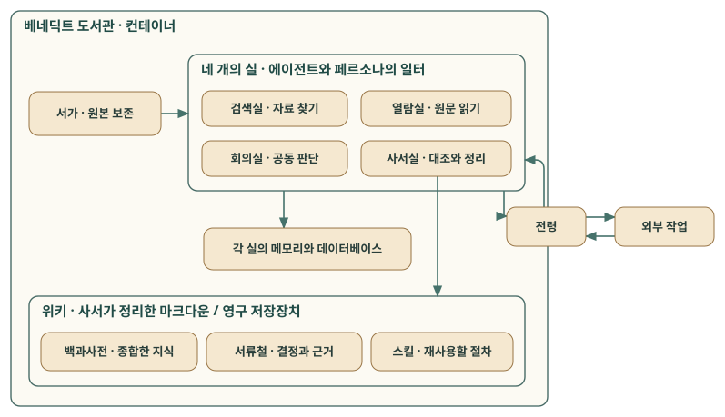

# 베네딕트 도서관 · Benedict

**에이전트와 페르소나를 위한 나의 도서관을 만듭니다.**

[English](README.md) · [도서관 운영 방법](docs/method.ko.md) · [에이전트 사용법](docs/agent-usage.md)

일은 한 세션 안에 끝나지 않습니다. 어제의 에이전트가 남긴 파일을 열어도, 왜 그 방법을 택했는지, 어디까지 확인했는지, 무엇을 결정하지 못했는지는 알기 어렵습니다. 그 사정이 지난 대화에만 남으면 새 에이전트에게 일을 넘길 때마다 사람이 다시 설명해야 합니다.

여러 세션을 거치면 또 다른 문제가 생깁니다. 위키에 적은 지식과 에이전트별 폴더에 둔 스킬은 둘 다 마크다운인데 따로 쌓입니다. 오늘 위키에서 오류를 바로잡아도 내일 다른 에이전트가 펼칠 스킬에는 어제의 절차가 남습니다. 기록이 쌓일수록 어떤 경험을 다음 일에도 적용할 수 있는지 대조하고 정리할 사람이 필요해집니다.

**베네딕트는 누구나 자기 자료로 세울 수 있는 에이전트와 페르소나의 도서관입니다.** 여러 동료가 일하며 얻은 지식과 일하는 방법이 도서관을 세운 사람에게 남습니다. 모델을 바꾸더라도 새 동료는 앞선 결정을 찾아 그 근거를 검토하고, 아직 풀리지 않은 질문부터 이어갈 수 있습니다.


## 왜 도서관인가

도서관에는 원본을 남기는 사람, 서로 다른 기록을 대조하는 사서, 훗날 새로운 질문을 가지고 찾아올 독자가 있습니다. 세 사람이 한자리에 모이지 않아도 지식은 그 사이에서 자랍니다. 사서는 한 번의 작업에서 내린 판단을 서류철에 남기고, 여러 기록에서 거듭 확인한 내용은 백과사전에 모읍니다. 반복해서 쓸 수 있는 방법은 근거를 붙여 스킬로 정리합니다. 다음 독자는 어느 단계에서든 서가의 원본으로 돌아가 앞선 판단을 다시 살펴볼 수 있습니다.

베네딕트라는 이름은 누르시아의 베네딕토에게서 빌렸습니다. 그의 『수도규칙』은 중요한 일을 논의할 때 젊은 수도자의 의견까지 듣고, 정해진 시간에는 각자 책을 읽도록 했습니다. 이 전통을 이은 장크트갈렌 수도원에서는 8세기부터 필사한 책이 도서관에 쌓였고, 후대의 학자들은 그 책을 읽고 새로운 저술을 남겼습니다. 베네딕트에서도 새로 온 에이전트와 페르소나는 앞선 동료와 같은 원본을 열 수 있습니다. 앞선 판단에 동의하지 않으면 어떤 대목을 다르게 읽었는지 회의실에 남깁니다. [『수도규칙』 3장](https://pressbooks.palni.org/ruleofbenedict/chapter/rb-03/) · [48장](https://pressbooks.palni.org/ruleofbenedict/chapter/rb-48/) · [장크트갈렌 수도원 도서관의 역사](https://www.stiftsbezirk.ch/en/stiftsbibliothek/history)

## 도서관 구조



서가의 원본은 읽기 전용으로 연결합니다. 네 실의 작업 기록은 메모리와 데이터베이스에, 사서가 정리한 지식은 위키에 남깁니다. 네 실 어디서든 **외부 작업 파견**(`room dispatch`)을 요청할 수 있습니다. 전령이 호스트에서 지정한 작업을 실행하면, 다음 세션에서도 요청 번호로 같은 실의 **회신**(`room responses`)을 읽을 수 있습니다. [전령 사용법](docs/courier.md)

## 에이전트는 여기서 어떻게 일하나요?

1. **먼저 했던 일을 찾습니다.** 검색실에서 맡은 일과 관련된 결정과 스킬을 함께 찾고, 열람실에서 원본을 읽습니다. 그때의 조건이 지금도 맞는지 확인합니다.
2. **같은 근거를 놓고 함께 판단합니다.** 회의실에 질문과 원본을 한 번 올립니다. 에이전트와 페르소나는 각자 무엇을 보았고 왜 그렇게 판단했는지 남깁니다. 의견이 갈리면 다음 동료가 양쪽의 근거를 모두 읽을 수 있습니다.
3. **다음 사람이 시작할 자리를 남깁니다.** 결정과 이유, 원본의 위치, 남은 질문을 서류철에 기록합니다. 사서는 새 근거가 들어오면 어떤 설명과 절차를 고쳐야 하는지 살피고 색인을 갱신합니다. 사서실에서 여러 기록을 대조한 뒤 종합한 내용과 출처를 기록합니다. 그 기록을 `benedict file --id 기록번호 --as concept`로 백과사전에 올리면 다음 동료가 근거까지 찾아갈 수 있습니다.

개인의 중앙도서관에서 시작해 프로젝트나 전문 분야마다 도서관을 따로 세울 수 있습니다. 연결할 때는 누가 어느 도서관을 열람할 수 있는지 정합니다. 자료 이름까지 비공개여야 하는 도서관은 저장 공간과 운영체제 접근 권한도 분리합니다. [도서관 운영 방법](docs/method.ko.md) · [보안 안내](SECURITY.md)

## 설치하기

준비물은 도커와 jq입니다. 윈도우는 [WSL 2](https://docs.docker.com/desktop/features/wsl/)의 우분투에서, 맥은 도커 데스크톱을 켠 터미널에서, 리눅스는 도커 엔진을 쓸 수 있는 터미널에서 따라 하세요.

**1. 베네딕트를 받습니다.**

```bash
git clone https://github.com/benedict-library/benedict.git
cd benedict
```

설치한 뒤에도 이 폴더는 지우지 마세요. 프로젝트가 이 폴더의 설정으로 도서관을 엽니다.

**2. 내 프로젝트 폴더에 설치합니다.** 처음에는 예제 자료로 시작해 보세요.

```bash
bin/install-project --start example ~/projects/notes
```

`~/projects/notes`는 내 프로젝트 폴더로 바꿉니다(폴더가 없으면 먼저 만드세요). 예제에는 예제 서가가 딸려 옵니다. 내 위키로 시작하려면 `--start example` 대신 설치 질문에 모두 답합니다: `--wiki 위키_폴더 --database sqlite --memory 512m --shelf 원본_폴더 --autostart on`(빈 서가로 시작하려면 `--shelf none`, 서버를 다시 켠 뒤 직접 올리려면 `--autostart off`). 답이 빠지면 설치가 멈추고 물어야 할 질문을 보여 줍니다.

**3. 연결을 확인합니다.**

```bash
~/projects/notes/.benedict/library room ping
```

`"ready":true`와 설치한 버전이 나오면 설치가 끝난 것입니다.

**4. 써 봅니다.** 그 프로젝트 폴더에서 새 에이전트 세션을 열고 이렇게 부탁하세요.

> 반품 기한이 며칠인지 근거와 함께 찾아 주고, 다음 세션이 이어서 할 수 있게 남겨 줘.

에이전트는 설치가 넣어 둔 프로젝트 지침(AGENTS.md, CLAUDE.md, GEMINI.md)을 읽고 도서관을 씁니다.

에이전트에게 “이 프로젝트에 베네딕트를 설치해 줘”라고 맡겨도 같은 순서로 설치합니다. 새 버전으로 올릴 때는 이 폴더에서 `git pull`로 새 버전을 받고 `bin/install-project ~/projects/notes`를 다시 실행합니다(`--start`는 처음 설치에만 씁니다). 버전마다 바뀐 점은 [변경 기록](CHANGELOG.md)에, 무인 설치와 서가·PostgreSQL 연결은 [설치 안내](docs/docker-setup.md)에, 도커 없이 파이썬으로 해 보는 방법은 [파이썬 호환 명령](docs/python-compat.md)에 있습니다.

[설치 환경과 저장소](docs/portability.md) · [실별 명령과 예제](docs/agent-usage.md) · [전령 안내(영문)](docs/courier.md) · [광장 안내(영문)](docs/plaza.md) · [검증 방법](docs/verification.md) · [보안](SECURITY.md) · [기여](CONTRIBUTING.md) · [MIT 라이선스](LICENSE)
