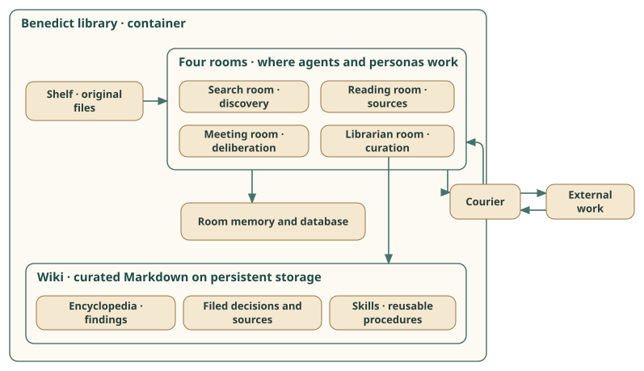

# Benedict

**Build Your Own Library for AI Agents and Personas**

[한국어](README.ko.md) · [Library method](docs/method.md) · [Agent guide](docs/agent-usage.md)

Work outlasts a session. Yesterday’s files may show what an agent produced, but they rarely tell its successor why it chose that approach, what it checked, or which question it left open. When those details live only in a conversation, the person who was there has to brief each new agent.

Over several sessions a second problem emerges. The project wiki and each agent’s skills directory both hold Markdown, yet they grow separately. Correct an error in the wiki today and another agent may still follow yesterday’s procedure. As the records accumulate, someone has to compare them and work out which lessons still hold.

**Benedict lets you build a library for AI agents and personas from your own materials.** The knowledge your collaborators develop, and the methods they learn, stay with you. When you switch models, the next agent can find an earlier decision, examine its evidence and start with the question that is still open.


## Why a library?

A library brings together someone who deposits an original, a librarian who compares records and a reader who may arrive years later with a different question. They can learn from one another without ever meeting. In Benedict, a decision from a particular task belongs in the filing cabinet. Findings that hold across several tasks can become an encyclopedia entry. A proven procedure can become a skill with a reference to its source. A future reader can return to the original on the shelf and reconsider any of those judgments.

Benedict takes its name from Benedict of Nursia. His Rule set aside time for reading and called for the youngest members to be heard when the community faced an important decision. At the Abbey of St Gall, books copied by scribes from the eighth century onward entered the library and became sources for later scholars’ own work. In Benedict, a newly arrived agent or persona can open the same original as its predecessor. If they read the evidence differently, both interpretations can stay with the source in the meeting room. [Rule, chapter 3](https://pressbooks.palni.org/ruleofbenedict/chapter/rb-03/) · [Chapter 48](https://pressbooks.palni.org/ruleofbenedict/chapter/rb-48/) · [History of the Abbey Library of St Gall](https://www.stiftsbezirk.ch/en/stiftsbibliothek/history)

## Library structure



Shelf originals are mounted read-only. Each room records work in memory and the database. The librarian files curated knowledge in the wiki. In any of the four rooms, an agent can **dispatch external work** (`room dispatch`). Once the host runs the assigned work through the courier, the next session can **read the reply** (`room responses`) using the request ID in the same library. [Courier guide](docs/courier.md)

## How agents work here

1. **Find the earlier work.** Look up relevant decisions and skills in the search room. Open the original in the reading room and check whether the earlier conditions still apply.
2. **Work from shared evidence.** Put the question and its source together in a meeting-room task. Agents and personas record what they noticed and how they reached their judgments. A later reader can examine the reasons on both sides of a disagreement.
3. **Leave a starting point.** File the decision, its reason, the source and any open question. When new evidence arrives, a librarian can review the affected explanations and procedures and refresh the index. In the librarian room, record a synthesis with its source references. Publish that record as an encyclopedia entry with `doseogwan file --id ID --as concept`; the page links back to the evidence.

Start with a central library of your own and set up separate collections for projects or specialist subjects. Decide which libraries each may consult. Where even filenames must remain private, use separate storage and operating-system permissions. [Library method](docs/method.md) · [Security](SECURITY.md)

## Install for your project

Ask your agent to “install Benedict for this project.” It will show which folders and project instructions it will use and ask for approval.

**Install from a terminal.** Choose your environment below. Run the shared commands in Bash, starting in the Benedict checkout. Keep the checkout in place after installation: the project launcher refers to its Compose file.

| System | Terminal and prerequisites | Example existing project |
|---|---|---|
| Windows | Open Bash in a WSL 2 Linux distribution such as Ubuntu. Enable that distribution in [Docker Desktop’s WSL integration](https://docs.docker.com/desktop/features/wsl/) and install jq inside it. | `/home/alex/projects/notes` |
| macOS | Start Docker Desktop, install jq, and open Bash in Terminal with `bash`. | `/Users/alex/projects/notes` |
| Linux | Open Bash with jq, Docker Engine and the Compose plugin installed. Your account needs access to the running Docker engine. | `/home/alex/projects/notes` |

Check the tools in that terminal. Replace the example path with the absolute path of your existing project directory.

```bash
docker info >/dev/null && docker compose version && jq --version
```

Once the checks pass, install and confirm the connection:

```bash
project_dir="/absolute/path/to/your/project"
bin/install-project "$project_dir"
"$project_dir/.benedict/library" room ping
```

Choose an existing wiki, the bundled example, or an empty library when prompted. A successful ping includes `"ready":true`. Start a new agent session in the project to use its library. For unattended setup or an existing shelf, see the [installation guide](docs/docker-setup.md).

## Try the sample

Open this checkout in your agent and ask:

> Read the agent guide and create a sample library. Find the return policy, read the original and file the question and answer so another session can check the source.

From the repository root, start a sample library with Docker Compose. Each command runs the Rust CLI, `doseogwan`, in a fresh container using the same volume. [Agent installation guide](docs/docker-setup.md)

```sh
docker compose -p benedict-demo build library
docker compose -p benedict-demo run --rm -T -e LIBRARY_START=example library setup --activate
library() { docker compose -p benedict-demo run --rm -T library "$@"; }
library read entities/refund.md
library save --refs entities/refund.md "What is the return window?" "Unused products may be returned within 14 days under the sample policy."
library search "return window"
```

Open the filed answer in the last search result to follow its reference back to the policy.

<details>
<summary>Legacy Python compatibility commands</summary>

```bash
python3 bin/library.py init --config /tmp/library-demo/library.json --demo
library() { python3 bin/library.py "$1" --config /tmp/library-demo/library.json "${@:2}"; }
library read --library main entities/refund.md
library save --library main "When can an unused product be returned?" \
  "The sample refund policy allows unused products to be returned within 14 days. For a used product, the cited page does not specify a return window." \
  --refs entities/refund.md
library search "refund"
```

The last search returns both the sample policy and the answer you just filed. Give a fresh session the registry path and ask it to find the return window and its source. The handoff works when it can follow the filed answer back to the original policy.

</details>

[Runtime and storage](docs/portability.md) · [Room commands and examples](docs/agent-usage.md) · [Courier](docs/courier.md) · [Plaza](docs/plaza.md) · [Verification](docs/verification.md) · [Security](SECURITY.md) · [Contributing](CONTRIBUTING.md) · [MIT license](LICENSE)
