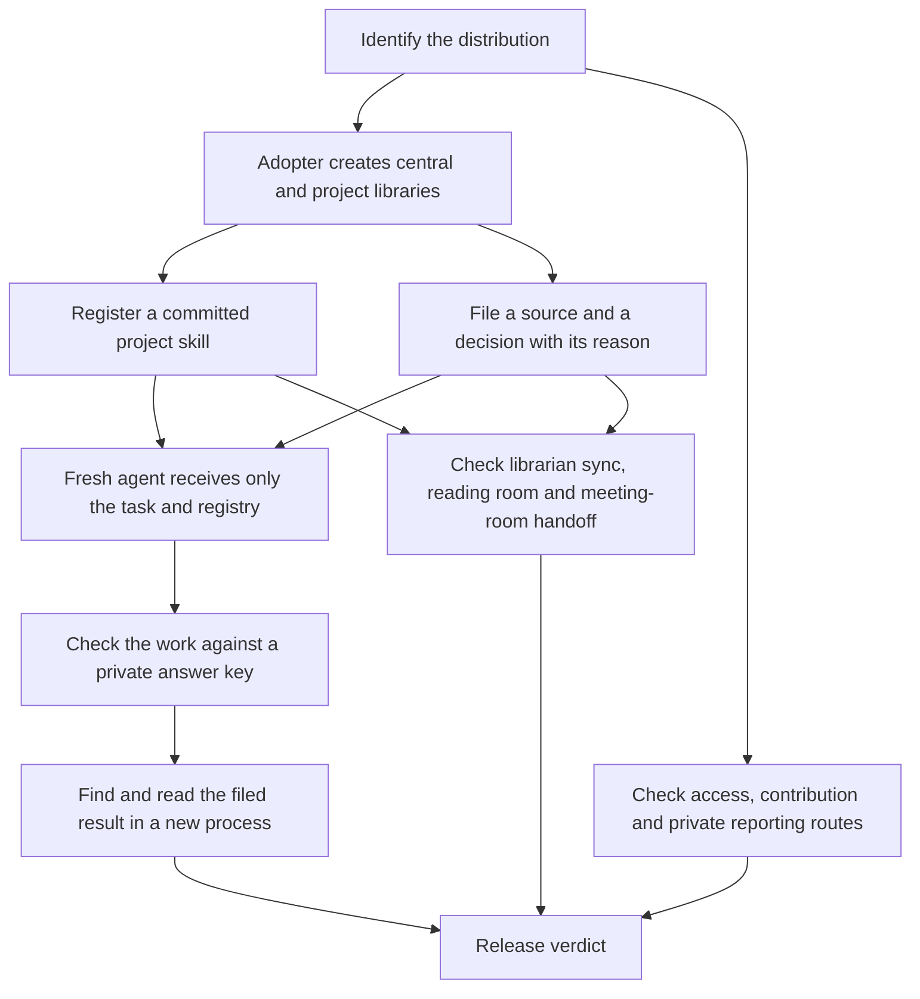

# Verify a library handoff

The test asks whether an adopter can build a project library and whether a fresh agent can use it to complete new work without the adopter's conversation. Use fictional data. Run the workflow on the exact revision or archive that a recipient will receive. If testing uncommitted changes, freeze a separate copy and report its results separately.

| Stage | Pass condition and evidence |
| --- | --- |
| P | Record the revision or archive digest. In a clean directory run the documented method and project-creation commands. If setup fails, mark downstream steps blocked for that distribution. |
| I | Give the adopter only the distribution and fictional project brief. Confirm an empty central library can find an authorized project after setup. Record any extra directions the adopter had to write. |
| S | Publish a skill from committed local Git sources. From its catalog card, locate the original at that revision. Give the skill a procedure whose result can be checked, such as lot size and dispatch label. |
| E | Supply an inspection note with a site-specific observation. Have the adopter record a decision and reference the note. Keep the expected answer outside the library. |
| H | Start a new agent with no chat history from the adopter. Supply the distribution, registry location and a new task. Include a changed condition. Do not supply source paths, skill name, expected quantities or earlier decision. |
| A | Check separately whether the agent consulted the skill and original, applied the procedure, explained its choice using the source, and reconsidered it under the changed condition. Record source versions, reads and resulting work. Grade an unobserved read as unverified. |
| F | Independently search the central library, open the new project record and read its decision, reasons and references. Check that its references lead to the material actually used. |
| L | In a dedicated room environment run one librarian cycle with original and skill lookup questions. Read the original from the reading room. Put the material in a named meeting-room task and retrieve it by task and key from another process. Report this plumbing check separately from the agent's own actions. |
| O | Verify the release location, license, setup and contribution instructions, automated tests, and a usable private reporting route. Check disclosure and redistribution rights for the exact files and history to be published. Record which controls were inspected and which were exercised. |

Use **pass**, **fail**, **blocked** or **unverified** per stage. Log any assistance or added guide. A pass after assistance describes that configuration. Repeat the affected stage from a clean copy to establish an unassisted pass. Preserve the prompts, test inputs, expected answers, actual work and file references with the results. One internal run establishes feasibility; an independent adopter's project is a separate acceptance test.

## Run the Rust grader for the Oak fixture

Build with `cargo build --locked --manifest-path verification/handoff/Cargo.toml`. Run `verification/handoff/target/debug/verify-library-handoff CHECKOUT REGISTRY` with an absolute checkout path and registry file. If using a custom Cargo target directory, run the binary from its `debug` directory. The verifier needs Python 3 and Git to exercise the distribution's own commands. It prints JSON and exits with 0 on a pass, 1 on a failed check, or 2 for invalid invocation.

For this fixture, use project key `depot`, put the skill repository in `shelf/` beside the registry, and store the camera test at `oak-inspection.md`. The test buyer needs 13 Oak markers. Grade against six per lot, the FIELD label and the source-backed colour decision. Give the successor only the buyer's task and registry; keep the grader, its answer key and the other agent's session outside its working copy.

The grader independently queries the central library, reads project pages, checks the skill card against the Git blob and inspects the current filed answer and references. It recognizes the English fixture's literal evidence. Inspect the reasoning and actual agent reads separately. Room synchronization, meeting material retrieval, and external access checks also require their own evidence. To check the grader, change 18 to 12 in a disposable copy of the filed order, rebuild its indexes, and verify it fails at A/F.
